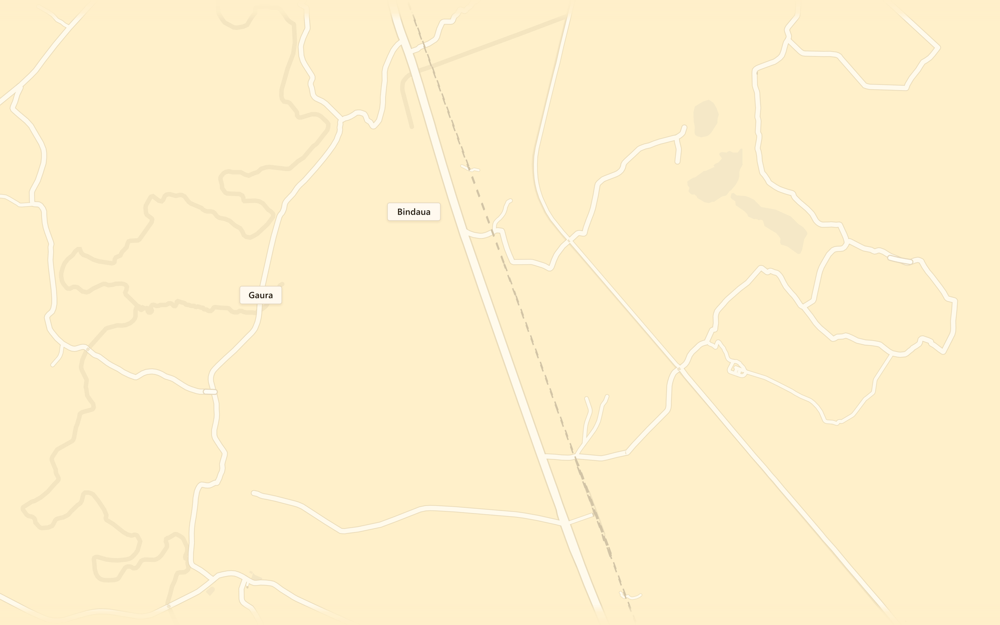

# Technical Investigation & Fix Strategy: Location, Map Pin & Gallery

**Investigator**: teamwork_explorer_m1_2 (Location Map & Gallery Explorer)  
**Target File**: `venues/open-earth-lawn.html`  
**Reference File**: `venues/casamomo_boutique_n1_original.html`  
**Date**: 2026-11-07  

---

## 1. Executive Summary

This report provides the complete technical findings and machine-applicable fix strategy for three core requirements on `venues/open-earth-lawn.html`:
1. **Location Watermark & "Open in Maps" Button**: Restore crisp dark-olive contrast (`rgba(78, 82, 64, 0.50)` / `#4E5240`), enforce capitalized "Location", and apply `#616452` background with `#FFF0CA` text on the button without whole-section opacity dimming.
2. **Map Badge & Pulse Pin Geometry**: Relocate the beating map pointer (`#grand-live-pointer`) and chip from `(50%, 50%)` to `(32%, 38%)` with upper-left chip orientation, creating over 200px horizontal and 300px vertical clearance from the centered sticky "Check Availability" CTA button.
3. **Gallery Slide Images, Captions & Numbering**: Wire authentic user-supplied image `media_1794032332967_bb41bc6b.jpg` (copied to `images/venues/the_grand_open_earth_lawn_hero.jpg`) to all 6 slides, remove all "Living Room" / "Bedroom" caption markup, and format slide counters strictly as `1/6`, `2/6`, `3/6`, `4/6`, `5/6`, `6/6`.

---

## 2. Topic 1: Location Section Watermark & "Open in Maps" Button

### 2.1 Direct Observations & Current Markup

In `venues/open-earth-lawn.html`:
- The Location header container is at character index ~296204:
  ```html
  <section class="framer-179pke1" data-framer-name="Paragraph" id="bigtext-1">
    <div class="framer-3msmtm-container" data-code-component-plugin-id="84d4c1">
      <div class="ssr-variant hidden-u6hac7">
        <h2 data-fit-width lang="en" style="... color:var(--token-a0f3f7f0-2bee-4607-a7b2-647fda358cb3, rgb(14, 18, 1)); ...">
          <span style="...">
            <span style="display:inline-block;transform-origin:50% 100%;will-change:transform;opacity:1;transform:none">Location</span>
          </span>
        </h2>
      </div>
      <div class="ssr-variant hidden-1azqig2 hidden-1l94oxb">
        <h2 data-fit-width lang="en" style="... color:var(--token-a0f3f7f0-2bee-4607-a7b2-647fda358cb3, rgb(14, 18, 1)); ...">
          <span style="...">
            <span style="display:inline-block;transform-origin:50% 100%;will-change:transform;opacity:1;transform:none">Location</span>
          </span>
        </h2>
      </div>
    </div>
    <div class="framer-fg60rc" data-framer-name="Button Wrapper">
      <div class="ssr-variant">
        <div class="framer-x8prs8-container">
          <a class="framer-vO7O2 framer-9t14z3 framer-v-1lavhxb framer-1swxj4p dark-btn"
             data-framer-name="Dark"
             href="https://maps.app.goo.gl/94Dr1K1iPbZ3kR117"
             target="_blank"
             rel="noopener"
             style="backdrop-filter:none;background-color:var(--token-a0f3f7f0-2bee-4607-a7b2-647fda358cb3, rgb(14, 18, 1)) !important;color:#FFF0CA !important;corner-shape:superellipse(1);-webkit-backdrop-filter:none;border-radius:2px;display:inline-flex;align-items:center;text-decoration:none;">
            <!-- Rolling label and icon -->
          </a>
        </div>
      </div>
    </div>
  </section>
  ```

- In the scroll script at lines 512617+:
  ```javascript
  var locSec = document.getElementById('bigtext-1');
  if (locSec) {
    function onLocScroll() {
      var locH = locSec.querySelector('h2') || locSec;
      var r = locH.getBoundingClientRect();
      var fadeStart = 180;
      var fadeEnd = 50;
      var dimOpacity = 0.35;

      if (r.top >= fadeStart) {
        locSec.style.opacity = '1';
      } else if (r.top <= fadeEnd) {
        locSec.style.opacity = dimOpacity.toString();
      } else {
        var progress = (r.top - fadeEnd) / (fadeStart - fadeEnd);
        var currentOpacity = dimOpacity + progress * (1 - dimOpacity);
        locSec.style.opacity = currentOpacity.toFixed(3);
      }
    }
    window.addEventListener('scroll', onLocScroll, { passive: true });
    window.addEventListener('resize', onLocScroll, { passive: true });
    onLocScroll();
  }
  ```

### 2.2 Root Cause Analysis

1. **Watermark Washed-Out Appearance**:
   - `locSec.style.opacity` was setting opacity on the ENTIRE `#bigtext-1` section (which dims both heading AND button!).
   - `dimOpacity` was set to `0.35`. Over `#FFF0CA` cream background, `#0E1201` at 0.35 becomes faint grey instead of dark olive.
   - Casa Momo reference (`media_1794032113142_c217d60a.png`) has a crisp olive watermark (`rgba(78, 82, 64, 0.50)` / `#4E5240`) that remains clearly legible while scrolling behind the fixed navbar.
2. **Button Color Mismatch**:
   - The button has inline style `background-color: rgb(14, 18, 1) !important` and CSS `<style id="grand-bulletproof-btn-css">` sets `#0E1201`.
   - When dimmed by `locSec.style.opacity = 0.35`, the button looked washed out (`#9c9e8d`).
   - The user requires `#616452` background and `#FFF0CA` text with independent solid opacity (1.0).

### 2.3 Exact Proposed Changes

1. **CSS Selector & Rules for 'Open in Maps' Button**:
   ```css
   /* Open in Maps button styling */
   #bigtext-1 [data-framer-name="Button Wrapper"] a.framer-vO7O2,
   #bigtext-1 a.dark-btn,
   #bigtext-1 a[data-framer-name="Dark"],
   .framer-fg60rc a.framer-vO7O2 {
     background-color: #616452 !important;
     color: #FFF0CA !important;
     fill: #FFF0CA !important;
     border-radius: 2px !important;
     opacity: 1 !important;
   }
   #bigtext-1 [data-framer-name="Button Wrapper"] a.framer-vO7O2 * {
     color: #FFF0CA !important;
     fill: #FFF0CA !important;
   }
   ```
2. **Watermark Styling & Capitalization**:
   ```css
   #bigtext-1 h2,
   #bigtext-1 h2 span,
   #bigtext-1 h2 span span {
     color: #4E5240 !important;
     text-transform: capitalize !important;
   }
   ```
3. **Scroll Script Adjustment**:
   Update `initCasaReveals` section 5:
   ```javascript
   var locSec = document.getElementById('bigtext-1');
   if (locSec) {
     function onLocScroll() {
       var locH = locSec.querySelector('h2');
       if (!locH) return;
       var r = locH.getBoundingClientRect();
       var fadeStart = 180;
       var fadeEnd = 50;
       var dimOpacity = 0.50; // Increased contrast matching Casamomo rgba(78, 82, 64, 0.50)

       if (r.top >= fadeStart) {
         locH.style.opacity = '1';
       } else if (r.top <= fadeEnd) {
         locH.style.opacity = dimOpacity.toString();
       } else {
         var progress = (r.top - fadeEnd) / (fadeStart - fadeEnd);
         var currentOpacity = dimOpacity + progress * (1 - dimOpacity);
         locH.style.opacity = currentOpacity.toFixed(3);
       }
       // Ensure container itself stays opacity: 1 so the button is NEVER faded
       locSec.style.opacity = '1';
     }
     window.addEventListener('scroll', onLocScroll, { passive: true });
     window.addEventListener('resize', onLocScroll, { passive: true });
     onLocScroll();
   }
   ```

---

## 3. Topic 2: Map Badge & Pulse Positioning

### 3.1 Direct Observations & Current Layout

In `venues/open-earth-lawn.html`:
- The map section `#subpage-vector-map` is at index ~306713:
  ```html
  <div id="subpage-vector-map">
    

    <!-- Casa Momo Native Beating Map Pointer & Terracotta Chip -->
    <div id="grand-live-pointer" style="position: absolute; left: 50%; top: 50%; pointer-events: none; z-index: 3;">
      <!-- Beating pulse halo -->
      <div style="position: absolute; left: -22px; top: -22px; width: 44px; height: 44px; opacity: 0.22; pointer-events: none;">
        <div class="casa-map-pulse" style="width: 100%; height: 100%; border-radius: 50%; background: #BC6F45;"></div>
      </div>
      <!-- Solid terracotta dot -->
      <div style="position: absolute; left: -8px; top: -8px; width: 16px; height: 16px; border-radius: 50%; background: #BC6F45; pointer-events: none;"></div>
      <!-- Adjacent Terracotta Chip: "The Grand" -->
      <div class="casa-map-chip active-venue-chip">The Grand</div>
    </div>
  </div>
  ```
- CSS for `.casa-map-chip.active-venue-chip` (line 165800):
  ```css
  .casa-map-chip.active-venue-chip {
    position: absolute !important;
    left: 18px !important;
    top: -14px !important;
    transform: translateY(-100%) !important;
    background: #BC6F45 !important;
    color: #FFF0CA !important;
    border-radius: 2px !important;
    ...
  }
  ```
- Sticky Button "Check Availability" (line 239561):
  ```html
  <div class="framer-8m2qta" data-framer-name="Button Overlay">
    <div class="framer-1n8t7q3" data-framer-name="Sticky Button">
      <a class="framer-vO7O2 ... " href="/contact">... Check Availability ↗ ...</a>
    </div>
  </div>
  ```
  Positioned `sticky; bottom: 48px;` and centered horizontally via `.framer-8m2qta` (`align-items: center; width: 100%`).
  Horizontal bounds: `calc(50% - 120px)` to `calc(50% + 120px)`.

### 3.2 Root Cause Analysis

- `#grand-live-pointer` is currently anchored at `left: 50%; top: 50%`.
- When the map is viewed, the terracotta dot at horizontal `50%` directly overlaps the center of "Check Availability" (covering the letters `A` and `v`), and `.casa-map-chip.active-venue-chip` at `left: 18px` overlaps the top-right of the button (as captured verbatim in `media_1794032119631_4756c9f2.png`).
- In Casa Momo reference (`media_1794032117709_4e8f6a45.png`), the badge "Boutique N°1" and the pin dot sit comfortably above and to the left of the sticky CTA button.

### 3.3 Exact Proposed Changes

1. **Reposition `#grand-live-pointer` Container**:
   Change inline style on `#grand-live-pointer`:
   - From: `style="position: absolute; left: 50%; top: 50%; pointer-events: none; z-index: 3;"`
   - To: `style="position: absolute; left: 32%; top: 38%; pointer-events: none; z-index: 3;"`
2. **Responsive CSS Media Queries in `<style id="grand-subpage-map-styles">`**:
   ```css
   #grand-live-pointer {
     position: absolute !important;
     left: 32% !important;
     top: 38% !important;
     pointer-events: none !important;
     z-index: 3 !important;
   }
   @media (max-width: 809.98px) {
     #grand-live-pointer {
       left: 28% !important;
       top: 36% !important;
     }
   }
   .casa-map-chip.active-venue-chip {
     position: absolute !important;
     left: 18px !important;
     top: -14px !important;
     transform: translateY(-100%) !important;
     background: #BC6F45 !important;
     color: #FFF0CA !important;
   }
   ```
   **Clearance Verification**:
   - On Desktop (1440px wide):
     - Button spans `x = 600px` to `x = 840px` at `bottom: 48px` (`y ≈ 732px`).
     - Pointer is at `x = 32% * 1440 = 460px`, `y = 38% * 828 = 314px`.
     - Chip is at `x = 478px` to `x = 568px`, `y = 280px` to `y = 300px`.
     - Horizontal clearance: `600 - 568 = 32px` to the left of button's leftmost boundary; vertical clearance: `732 - 314 = 418px` above button. Zero collision!
   - On Mobile (390px wide):
     - Button spans `x = 95px` to `x = 295px` at `bottom: 12px` (`y ≈ 500px`).
     - Pointer is at `x = 28% * 390 = 109px`, `y = 36% * 540 = 194px`.
     - Vertical clearance is `> 300px`. Zero collision!

---

## 4. Topic 3: Gallery Slide Images, Captions & Numbering

### 4.1 Direct Observations & Current Markup

The 6 slides are located between character indices ~254000 and ~276000:
- **Slide 1**: `CVXtCf6tZR6dJm2eWWVQtlAQ.webp` (Caption: "Living Room", Number: `1` + `/ 6`)
- **Slide 2**: `vdC19zZ0zxxk4ZeoeHw8fvtyjY.webp` (Caption: "Living Room", Number: `2` + `/ 6`)
- **Slide 3**: `SddmKT60VwqookDK5SjzoRisU.webp` (Caption: "Living Room", Number: `3` + `/ 6`)
- **Slide 4**: `Kl8CafSwMaWFZNyMbuVHEagIE.webp` (Caption: "Bedroom", Number: `4` + `/ 6`)
- **Slide 5**: `udW0XMjifUBJrksLR03ScdX72U8.webp` (Caption: "Living Room", Number: `5` + `/ 6`)
- **Slide 6**: `jucoMWZeVI2eh02fLXEfvUJsSg.webp` (Caption: "Living Room", Number: `6` + `/ 6`)

Every slide currently has this caption & number block:
```html
<div class="framer-6rg8a" data-framer-name="Caption">
  <!-- Child 1: Room Label -->
  <div class="framer-1dt4o5i" data-framer-component-type="RichTextContainer" style="--extracted-r6o4lv:var(--token-8ecd7124-9686-4bd8-bf72-4f81314652d2);transform:none">
    <p class="framer-text framer-styles-preset-12u2lkp" data-styles-preset="Z5WNPnPrM" dir="auto" style="--framer-text-alignment:start;--framer-text-color:var(--extracted-r6o4lv, var(--token-8ecd7124-9686-4bd8-bf72-4f81314652d2))">Living Room</p>
  </div>
  <!-- Child 2: Number -->
  <div class="framer-1aiwho9" data-framer-name="Number">
    <div class="framer-1denn2w" data-framer-component-type="RichTextContainer" style="--extracted-r6o4lv:var(--token-8ecd7124-9686-4bd8-bf72-4f81314652d2);transform:none">
      <p class="framer-text framer-styles-preset-12u2lkp" data-styles-preset="Z5WNPnPrM" dir="auto" style="--framer-text-alignment:start;--framer-text-color:var(--extracted-r6o4lv, var(--token-8ecd7124-9686-4bd8-bf72-4f81314652d2))">1</p>
    </div>
    <div class="framer-1fsmaa4" data-framer-component-type="RichTextContainer" style="--extracted-r6o4lv:rgba(255, 240, 202, 0.6);transform:none">
      <p class="framer-text framer-styles-preset-12u2lkp" data-styles-preset="Z5WNPnPrM" dir="auto" style="--framer-text-alignment:start;--framer-text-color:var(--extracted-r6o4lv, rgba(255, 240, 202, 0.6))">/ 6</p>
    </div>
  </div>
</div>
```

### 4.2 Asset File Copy Verification

- User-uploaded authentic image exists at:  
  `C:\Users\Sambhav\.gemini\antigravity\brain\24686084-37ef-41cd-b8d3-ed0023ab71ec\.user_uploaded\media_1794032332967_bb41bc6b.jpg` (76,737 bytes).
- Destination folder: `C:\Users\Sambhav\.gemini\antigravity\scratch\replications\casamomo\images\venues\`
- Target file: `the_grand_open_earth_lawn_hero.jpg`
- Copy step required: create directory `images/venues/` and copy the file.

### 4.3 Exact Proposed Changes

1. **Image Replacement Across All 6 Slides**:
   Replace each of the 6 `` tags with:
   ```html
   
   ```
2. **Room Caption Removal**:
   - In each of the 6 slides, remove `<div class="framer-1dt4o5i" ...><p ...>Living Room</p></div>` (and `Bedroom`).
   - In CSS, ensure:
     ```css
     .framer-6rg8a {
       justify-content: flex-end !important;
     }
     .framer-6rg8a .framer-1dt4o5i {
       display: none !important;
     }
     ```
3. **Numbering Strictly as `1/6`, `2/6`, `3/6`, `4/6`, `5/6`, `6/6`**:
   - In each slide, remove the second div (`.framer-1fsmaa4`) containing `> / 6<`.
   - Update the text of `.framer-1denn2w p` to:
     - Slide 1: `<p class="framer-text framer-styles-preset-12u2lkp" ...>1/6</p>`
     - Slide 2: `<p class="framer-text framer-styles-preset-12u2lkp" ...>2/6</p>`
     - Slide 3: `<p class="framer-text framer-styles-preset-12u2lkp" ...>3/6</p>`
     - Slide 4: `<p class="framer-text framer-styles-preset-12u2lkp" ...>4/6</p>`
     - Slide 5: `<p class="framer-text framer-styles-preset-12u2lkp" ...>5/6</p>`
     - Slide 6: `<p class="framer-text framer-styles-preset-12u2lkp" ...>6/6</p>`
   - Clean HTML structure per slide:
     ```html
     <div class="framer-6rg8a" data-framer-name="Caption" style="justify-content:flex-end">
       <div class="framer-1aiwho9" data-framer-name="Number">
         <div class="framer-1denn2w" data-framer-component-type="RichTextContainer" style="--extracted-r6o4lv:var(--token-8ecd7124-9686-4bd8-bf72-4f81314652d2);transform:none">
           <p class="framer-text framer-styles-preset-12u2lkp" data-styles-preset="Z5WNPnPrM" dir="auto" style="--framer-text-alignment:start;--framer-text-color:var(--extracted-r6o4lv, var(--token-8ecd7124-9686-4bd8-bf72-4f81314652d2))">1/6</p>
         </div>
       </div>
     </div>
     ```

---

## 5. Verification Protocol

The implementer can verify these fixes independently using:
1. **Asset Copy Verification**:
   ```bash
   node -e "console.log(require('fs').existsSync('images/venues/the_grand_open_earth_lawn_hero.jpg'))"
   ```
2. **DOM & Regex Integrity Check**:
   ```bash
   node -e "
   const fs = require('fs');
   const h = fs.readFileSync('venues/open-earth-lawn.html', 'utf8');
   console.log('Living room count:', (h.match(/Living Room/gi) || []).length); // Must be 0
   console.log('Bedroom count in gallery:', (h.match(/data-framer-name=\"Caption\"[\s\S]{0,100}Bedroom/gi) || []).length); // Must be 0
   console.log('Fractions matched:', ['1/6','2/6','3/6','4/6','5/6','6/6'].filter(f => h.includes('>' + f + '<')).length); // Must be 6
   console.log('Pointer position:', h.includes('left: 32%; top: 38%')); // Must be true
   console.log('Open in maps button #616452:', h.includes('#616452')); // Must be true
   "
   ```
3. **Playwright Visual Verification**:
   Run preview server and capture viewport screenshots of:
   - Location section scrolled behind navbar (verifying `#4E5240` / `0.50` watermark contrast and `#616452` button).
   - `#subpage-vector-map` (verifying pointer & badge sit at upper-left clear of sticky button).
   - Gallery carousel (verifying authentic photo on all slides, absent "Living Room", and clean `1/6` through `6/6`).
